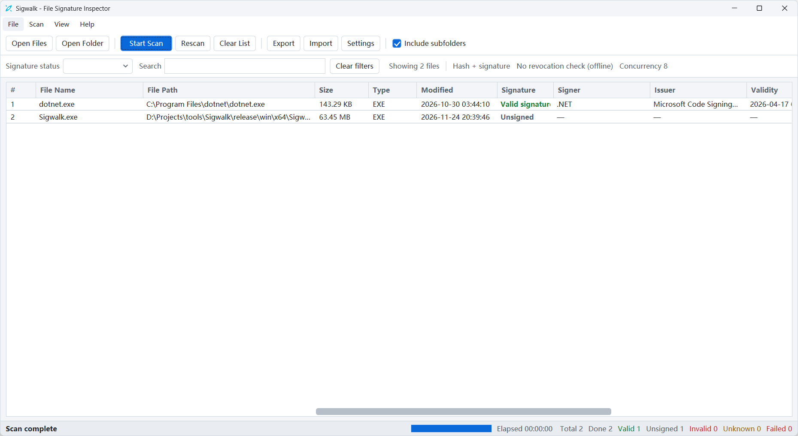
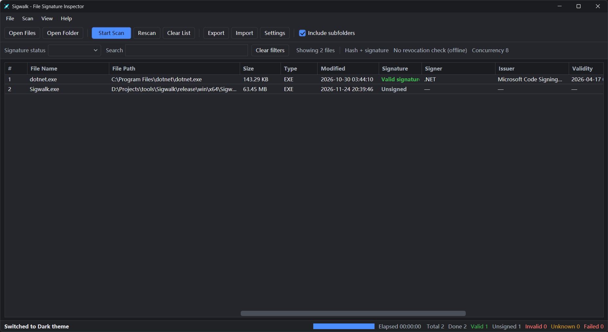

# Sigwalk

Sigwalk is a Windows file signature inspection tool. It batch-checks Authenticode digital signatures on EXE, DLL, SYS, MSI and similar files, and computes SHA1 / SHA256 hashes.



## Features

- Import a single file, a single folder, multiple folders, drag-and-drop, or paste multiple paths with Ctrl+V.
- Configurable recursive scanning, file type filtering, and concurrency.
- Verifies embedded Authenticode signatures with Windows `WinVerifyTrust`, distinguishing **Valid / Unsigned / Invalid / Unknown**.
- Shows signer, certificate issuer, serial number, thumbprint, validity period, signature algorithm, timestamp signer and time, and certificate chain status.
- Supports multiple and nested signatures; a file is Valid when any signature passes system trust, with a warning for signatures that fail.
- Streams each file once to compute both SHA1 and SHA256; results are shown separately in uppercase hexadecimal.
- DataGrid supports sorting, column resizing, column visibility (configurable in Settings and persisted), copying, double-click to open, context menu, and Show in Explorer.
- Filter bar provides signature-status filtering and unified search (file name, path, extension, signer, issuer, SHA1, SHA256), combinable with AND.
- The scan button combines Start/Cancel; rescan and dynamic file addition are supported; the UI stays responsive while scanning.
- **Rescan re-enumerates imported files/folders against the current disk**: deleted files are removed, new files are added, and existing files have their signature and hashes re-read.
- Exports CSV / Excel (XLSX) / JSON with All / Compact content, producing a detection summary plus grouped details.
- Saves and imports scan results (JSON; compatible with v1 snapshot files and v2 grouped export files).
- The file details window shows the full certificate, timestamp, certificate chain, PE version resource, and hashes.
- Themes: Auto / Light / Dark (Auto follows the system); the menu and title bar switch together.
- Instant Chinese/English UI switching; every feature ships with bilingual strings.
- Command-line mode: headless batch scanning, console progress and statistics, CSV/JSON/XLSX export, and well-defined exit codes.
- Keyboard shortcuts, remembered settings, and logging.



## Requirements

- Windows 10 / Windows 11 (x64; the build script also supports win-x86 publishing)
- Development and build: .NET SDK 8.0 or later
- Running the published artifact: no .NET Runtime installation required (self-contained single-file publish)

## Quick Start

```bat
cd Sigwalk
scripts\build.bat
release\win\x64\Sigwalk.exe
```

You can also run it directly from the SDK:

```powershell
& "C:\Program Files\dotnet\dotnet.exe" run --project src\Sigwalk\Sigwalk.csproj -c Release
```

> On some machines `dotnet` is not on `PATH`; the script falls back to `%ProgramFiles%\dotnet\dotnet.exe` automatically.

## Usage

### Adding files

- Menu: File → Open Files / Open Folder / Add Files / Add Folder.
- The toolbar provides Open Files / Open Folder; Add and Paste Paths live in the File menu.
- Drag files or folders from Explorer onto the window.
- Copy paths and press **Ctrl+V** (one path per line; spaces and quotes are supported).
- Open clears the current list before importing; Add appends to it. Duplicate paths are ignored automatically.

### Scanning

- The toolbar scan button shows **Start Scan** when idle and **Cancel Scan** while scanning; clicking it performs the corresponding action.
- **Start Scan (F5)**: scans all pending files and files that failed in the previous run.
- **Cancel (Esc)**: takes effect at file boundaries; `WinVerifyTrust` itself cannot be interrupted, so the file currently being verified finishes first.
- **Rescan**: with a selection, rescans only the selected files; with no selection, rescans everything. Every rescan re-enumerates the imported files/folders and reconciles deletions, additions, and content changes.
- Files can still be added during a scan; new files join the current scan queue automatically.
- Results are merged into the table in batches so large scans do not freeze the UI.
- Pause has been removed from the current version (no Pause/Resume entry).

### Filtering and search

- Signature status: All / Signed / Unsigned / Invalid / Unknown / Scan failed.
- Search: matches file name, full path, file type (extension), signer, certificate issuer, SHA1, and SHA256 at once. Extension filtering is folded into search.
- Conditions are combined with AND; clearing filters never modifies the underlying results.

### Context menu

- Open file, open containing folder, reveal in Explorer (`explorer /select,`).
- Copy selected rows, path, name, SHA1, SHA256, signature information.
- View full certificate information, rescan selected, remove selected.
- Right-click a column header to show or hide columns.

### Details window

Select a file and click View Details in the toolbar or choose View Full Certificate Information from the context menu:

- **Basic information**: path, size, type, timestamps, scan/signature status, PE version resource.
- **Signature information**: every certificate field for each signature, timestamp, certificate chain, verification method, and failure reason.
- **Hashes**: full SHA1 / SHA256 values with copy buttons.

### Theme, language, and column visibility

- View → Theme → **Auto (default, follow system) / Light / Dark**; the active item is checked, and the change applies immediately, including the title bar.
- View → Language → **Chinese (default) / English**; menus, toolbar, headers, status bar, dialogs, and settings update immediately.
- Settings → Grid columns: toggle each column and persist the choice; column headers also offer a quick right-click toggle. Hidden columns affect display only, not data or exports.

### Settings

The Settings window centralizes:

- Scan: recursion, file types, concurrency, scan mode, revocation checking, auto-sort after completion.
- Export: format (CSV default / JSON / XLSX), content (All / Compact, default Compact).
- Interface: theme (Auto/Light/Dark), language (Chinese/English).
- Grid column visibility.

### Export and save

- Toolbar **Export** or File → Export: uses the format and content configured in Settings.
  - **All**: exports every result (Valid, Unsigned, Invalid, Unknown, Failed).
  - **Compact (default)**: exports only Unsigned, Invalid, Unknown, and Failed files, omitting Valid ones.
- Exports start with a **detection summary** (result, total, completed, valid, unsigned, invalid, unknown, failed), followed by details in a fixed group order; groups with a count of 0 are still included and marked "None".
- File → Export Filtered: exports the current view with the current filters and sorting.
- File → Save Results: saves a v1 JSON working snapshot; **Import** accepts both v1 snapshot files and v2 grouped exports.
- CSV uses UTF-8 BOM + CRLF for easy Excel opening; XLSX is native OOXML; JSON uses a clear summary + grouped structure with no third-party dependencies.

### Keyboard shortcuts

| Shortcut | Action |
|---|---|
| Ctrl+O | Open files |
| Ctrl+Shift+O | Open folder |
| Ctrl+V | Paste paths |
| F5 | Start scan |
| Esc | Cancel scan |
| Ctrl+F | Focus the search box |
| Delete | Remove selected |
| Ctrl+C | Copy selected rows |
| Ctrl+S | Save results |

### Command line

The published artifact also runs headless, using exactly the same discovery, signature verification, and export logic as the GUI:

```bat
:: Scan a folder and export a compact CSV
Sigwalk.exe C:\Tools --recursive --output result.csv --format csv --content compact

:: Scan and print results without exporting
Sigwalk.exe C:\Tools\a.exe --lang en

:: Return exit code 5 when unsigned/invalid/unknown/failed files exist
Sigwalk.exe C:\Tools --fail-on-issues

:: Show help
Sigwalk.exe --help
```

Common options:

| Option | Description |
|---|---|
| positional path | One or more files/folders (required, except for `--help`/`--version`) |
| `-r, --recursive` / `--no-recursive` | Recurse or not (recursive by default) |
| `-e, --ext <list>` | Extension filter, e.g. `exe;dll;sys` |
| `-j, --concurrency <1-32>` | Concurrency |
| `-m, --mode <full\|signature\|hash>` | Scan mode |
| `--revocation <none\|cache\|online>` | Revocation checking |
| `-f, --format <csv\|json\|xlsx>` | Export format (requires `--output`) |
| `-c, --content <all\|compact>` | Export content (requires `--output`) |
| `-o, --output <path>` | Export file |
| `--lang <zh\|en>` | UI/output language |
| `--fail-on-issues` | Return 5 when files requiring attention exist |
| `-q, --quiet` | Do not print per-file results |
| `-h, --help` / `-V, --version` | Help / version |

Exit codes: `0` success; `1` unexpected error; `2` invalid arguments; `3` file not found / invalid path; `4` export failed; `5` files requiring attention (only with `--fail-on-issues`); `130` cancelled by user.

### Configuration and logs

- Settings: `%APPDATA%\Sigwalk\settings.json`
- Logs: `%APPDATA%\Sigwalk\logs\sigwalk-yyyyMMdd.log`
- Menu Help → Open Log Folder opens the log directory directly.

## Signature status

| Status | Meaning |
|---|---|
| Valid | An embedded signature exists and `WinVerifyTrust` validated it under the system trust policy |
| Unsigned | No embedded Authenticode signature was found |
| Invalid | A signature exists, but the digest does not match, the certificate is expired/untrusted/revoked/misused, etc. |
| Unknown | Verification threw an exception or could not be classified, so the status cannot be determined |

Scan status is independent of signature status:

| Status | Meaning |
|---|---|
| Pending | Added to the list but not scanned yet |
| Scanning | Queued or currently being processed |
| Completed | Scanning finished (see the signature status table above) |
| Failed | File missing, access denied, locked, read error, changed during the scan, etc. |

## How scanning works

1. Calls `WinVerifyTrust(WINTRUST_ACTION_GENERIC_VERIFY_V2, WTD_CHOICE_FILE)` for the authoritative result under system trust policy.
2. Uses `WINTRUST_SIGNATURE_SETTINGS` with `WSS_GET_SECONDARY_SIG_COUNT` / `WSS_VERIFY_SPECIFIC` to verify the primary and additional signatures one by one.
3. Before closing the state data, copies the signer certificate, certificate chain, timestamp signer, and timestamp details via `WTHelperProvDataFromStateData` / `WTHelperGetProvSignerFromChain`.
4. Probes for an embedded PKCS#7 signature with `CryptQueryObject` to distinguish "unsigned" from "signature present but verification failed".
5. Best-effort parses nested signatures (OID `1.3.6.1.4.1.311.2.4.1`) from the PE security directory and `SignedCms` for display only; it never overrides the WinVerifyTrust result.
6. Hashes with `IncrementalHash` in a single streaming pass, computing SHA1 and SHA256 together with a 1 MB buffer, without loading the whole file into memory.
7. Compares file size and last write time before and after scanning; if the file changed, the result is discarded and marked Failed.

### Revocation checking

Settings → Certificate revocation checking offers three modes:

- **Do not check revocation (default, offline)**: no network access, fast; revocation status is shown as "not checked".
- **Use cached revocation information**: only local CRL/OCSP caches are used.
- **Online revocation checking**: allows network access and can be noticeably slower; reducing concurrency is recommended.

Chain trust is always decided by system policy and chain errors are never ignored. When revocation information is temporarily unavailable, the result is "Valid signature + unknown revocation status" with a warning, rather than an invalid signature.

## Project structure

```text
Sigwalk/
├── CLAUDE.md                 # Claude Code project notes
├── README.md
├── Sigwalk.sln
├── global.json
├── Directory.Build.props
├── .claude/                  # agents / skills / rules
├── src/
│   ├── Sigwalk.Core/         # models, signature verification, hashing, scanning, export, settings (no WPF)
│   │   ├── Models/
│   │   ├── Interop/          # WinTrust / Crypt32 P/Invoke
│   │   ├── Localization/     # embedded Chinese/English JSON string tables
│   │   ├── CommandLine/      # CLI argument parsing, exit codes, usage
│   │   ├── Services/
│   │   │   ├── Signature/    # Authenticode, WTHelper, nested signatures
│   │   │   ├── Scanning/     # ScanCoordinator, PauseToken, ScanInputTracker, RescanPlanner
│   │   │   └── Export/       # CSV / XLSX / JSON (summary + groups)
│   │   ├── Logging/
│   │   └── Utilities/
│   └── Sigwalk/              # WPF app (MVVM)
│       ├── Views/
│       ├── ViewModels/
│       ├── Services/         # theme, window title bar, dialogs
│       ├── Localization/     # XAML localization markup extension
│       ├── Cli/              # headless runner, console attachment
│       ├── Interop/          # DWM title bar
│       ├── Converters/
│       ├── Helpers/
│       └── Resources/Themes/
├── tests/Sigwalk.Tests/      # xUnit, references Core only
├── scripts/build.bat         # one-click build and publish
└── docs/screenshots/
```

## Build and publish

One-click publish:

```bat
scripts\build.bat
```

The script performs these steps:

1. Locates the .NET SDK (PATH or the default install directory).
2. `dotnet restore`.
3. Release build.
4. Runs unit tests.
5. Cleans `release\win\x64` (publish directory only).
6. Self-contained, single-file win-x64 publish.
7. Verifies `Sigwalk.exe` and creates `release\Sigwalk-win-x64-<version>.zip`.

Optional arguments/environment variables:

| Usage | Description |
|---|---|
| `scripts\build.bat x86` | Publish win-x86 |
| `set SKIP_TESTS=1` | Skip tests |
| `set SINGLE_FILE=0` | Disable single-file publish |
| `set NO_ZIP=1` | Do not create the ZIP |

Output:

```text
release/
├── Sigwalk-win-x64-1.0.0.zip
└── win/
    └── x64/
        └── Sigwalk.exe
```

Publish flags include `PublishSingleFile`, `IncludeNativeLibrariesForSelfExtract`, and `EnableCompressionInSingleFile`; trimming is disabled (WPF does not support trimming).

## Tests

```powershell
& "C:\Program Files\dotnet\dotnet.exe" test tests\Sigwalk.Tests\Sigwalk.Tests.csproj -c Release
```

There are currently 96 tests covering:

- P/Invoke struct sizes and key offsets (x64).
- SHA1/SHA256 known vectors, empty files, large files, cancellation.
- Recursive/non-recursive discovery, extension filtering, deduplication, pasted-path parsing.
- Filter/search combinations (including extension search), settings round-trips (BOM, new fields), logging.
- CSV / JSON / XLSX flat and grouped structures, summary counts, compact/all scopes, zero-count groups marked "None", v1/v2 import compatibility.
- Chinese/English key and placeholder parity in the localization tables, missing-key fallback, language switching.
- CLI argument parsing, error classification, and export option constraints.
- Rescan reconciliation (removed/added/kept, selected subset, case sensitivity, no-root scenarios).
- Pause latch, scan coordinator (concurrency, cancellation, dynamic addition, per-file failure).
- Signature error-code mapping, recursive nested-signature parsing (built with self-signed certificates).
- Real-signature smoke tests: unsigned file → Unsigned; `dotnet.exe` → Valid + certificate/timestamp; tampered copy → Invalid. Skipped gracefully when system samples are unavailable.

## Known limitations

1. **Only embedded Authenticode signatures are checked; Windows catalog (Catalog) signatures are not.** Some files signed only via the system catalog appear as "Unsigned". This is the main reason results can differ from `Get-AuthenticodeSignature`.
2. Nested signatures are display-only and do not participate in the file's overall status; the authoritative result is WinVerifyTrust's verdict for each signature index.
3. `WinVerifyTrust` cannot be interrupted; cancelling a scan takes effect at file boundaries.
4. Revocation is not checked online by default; switch to online mode in Settings when strict revocation checks are required.
5. The first launch of the single-file build must extract native libraries, so startup may be slightly slower; some antivirus products may be sensitive to the self-extracting behavior.
6. Windows x64 is the primary target; x86 publishing works but is not the default validation target.
7. The "Compact" export intentionally omits valid files; re-importing that JSON restores only the exported groups. Use Save Results for a complete save/restore.
8. The "Unknown" count in the export summary includes files that are incomplete, were not signature-checked (for example, hash-only mode), or whose signature status cannot be determined; the counts always sum to the total.
9. Language switching updates menus, headers, the status bar, Settings, and newly produced messages immediately; errors and signature descriptions already written into result objects are snapshots and are not retranslated.
10. Command-line output is UTF-8; when using older consoles or redirecting to a file, read it as UTF-8.

## FAQ

**Why do some system files show as unsigned?**

They may only have a catalog signature, and this version verifies embedded signatures only. Compare with `Get-AuthenticodeSignature`; a result of `CatalogSigned` confirms this case.

**Why are some files slow to scan?**

Online revocation checking, downloading certificate chains, or many small files can all slow things down. Switch to the default offline mode or adjust concurrency (Settings → Concurrency).

**What happens to locked or inaccessible files?**

That file is marked Failed with the error recorded, and other files continue scanning. Details are available in the details window, the status column tooltip, and the logs.

**Where did Pause go?**

The Pause/Resume entry was removed in the current version by request. Cancelling still only takes effect at file boundaries; the file currently being verified finishes first.

**How do I use it in scripts?**

See "Command line" above: export with `--output` and use exit codes `0/2/3/4/5` to decide the outcome; add `--fail-on-issues` when any issue should fail the step.
